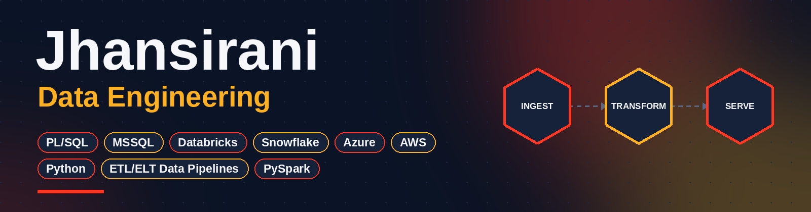

  

  <b>Data Engineer</b> | SQL & Oracle PL/SQL | Python | Cloud Data Engineering | AI & RAG

  
  

---

## 👩‍💻 About Me

I am a Computer Science postgraduate with professional experience in **SQL, Oracle PL/SQL and database development**, along with hands-on experience building Data Engineering projects using **Python, PySpark, AWS, Azure, Databricks and Snowflake**.

I'm currently strengthening my Data Engineering and AI skills through practical, end-to-end projects involving ETL pipelines, cloud storage, data ingestion, CDC, Delta Lake, Snowflake Streams & Tasks, data transformation, document processing, embeddings, vector databases, RAG and LLM-based applications.

I'm particularly interested in building data pipelines that prepare structured and unstructured data for analytics and AI applications, while continuing to develop practical skills across cloud data platforms and modern AI technologies.

---

## 🚀 Technical Skills & Stack

**Programming & Databases**

**Data Engineering**

**AWS**

**Azure**

**Development Tools**

---

## 🎓 Databricks Learning Journey

Completed **8 Databricks Academy courses** in October 2026 while preparing for the **Databricks Certified Data Engineer Associate** exam.

| # | Course | Completed |
|---|--------|-----------|
| 1 | Data Ingestion with Lakeflow Connect | 2026-10-11 |
| 2 | Deploy Workloads with Lakeflow Jobs | 2026-10-12 |
| 3 | Build Data Pipelines with Spark Declarative Pipelines | 2026-10-13 |
| 4 | Advanced Techniques with Spark Declarative Pipelines | 2026-10-13 |
| 5 | DevOps Essentials for Data Engineering | 2026-10-14 |
| 6 | Automated Deployment with Declarative Automation Bundles | 2026-10-17 |
| 7 | Databricks Data Privacy | 2026-10-20 |
| 8 | Databricks Performance Optimization | 2026-10-24 |

  

---

## 📂 Featured Data Engineering Projects

> More projects will be added here as they are completed and polished.

### 🔹 Real-Time Sales Data Ingestion Pipeline
`Python` `Boto3` `Amazon Kinesis` `AWS S3` `Snowflake` `Snowpipe` `Streams` `Tasks`

End-to-end practice project demonstrating real-time data generation, AWS ingestion, automated Snowflake loading and incremental CDC processing.

➡️ [View Project Repository](https://github.com/Jhansisrani/realtime-kinesis-s3-snowflake-autoingestion)

### 🔹 Automated Snowflake ELT & CDC Pipeline – Bookstore Data
`Snowflake` `SQL` `Amazon S3` `Snowpipe` `Streams` `Tasks` `MERGE`

End-to-end practice project demonstrating automated S3 ingestion, Snowflake ELT transformations, data-quality validation, error handling, CDC processing and incremental production loading.

➡️ [View Project Repository](https://github.com/Jhansisrani/snowflake-elt-cdc-pipeline)

---

## 📚 Data Engineering Learning

Hands-on practice with scenarios involving:

- Snowflake and dbt
- ETL & ELT pipelines
- Batch and real-time data ingestion
- Snowflake Streams & Tasks
- CDC and incremental processing
- Data quality and validation
- MERGE and upsert operations
- Delta Lake, schema enforcement & schema evolution
- AWS S3, Glue & Kinesis
- Azure ADLS Gen2, Data Factory & Databricks
- Databricks & PySpark
- Auto Loader & Structured Streaming in Databricks
- Schema evolution in Structured Streaming
- Windows & watermarks in Structured Streaming

---

## 💼 Professional Background

- Professional experience in Oracle PL/SQL and SQL
- Database development and application support experience
- Experience working with Oracle, MySQL and SQL Server
- Currently building hands-on Data Engineering projects to strengthen cloud and modern data platform skills

---

## 📊 GitHub Activity

  
  

---

## 🤝 Connect With Me

- 💼 LinkedIn: [Jhansirani](https://www.linkedin.com/in/jhansirani-s-a1b24a36/)
- 💻 GitHub: [Jhansisrani](https://github.com/Jhansisrani)

⭐ Thanks for visiting my profile!
